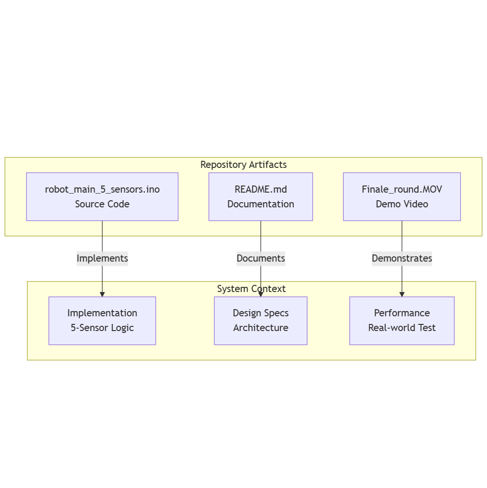
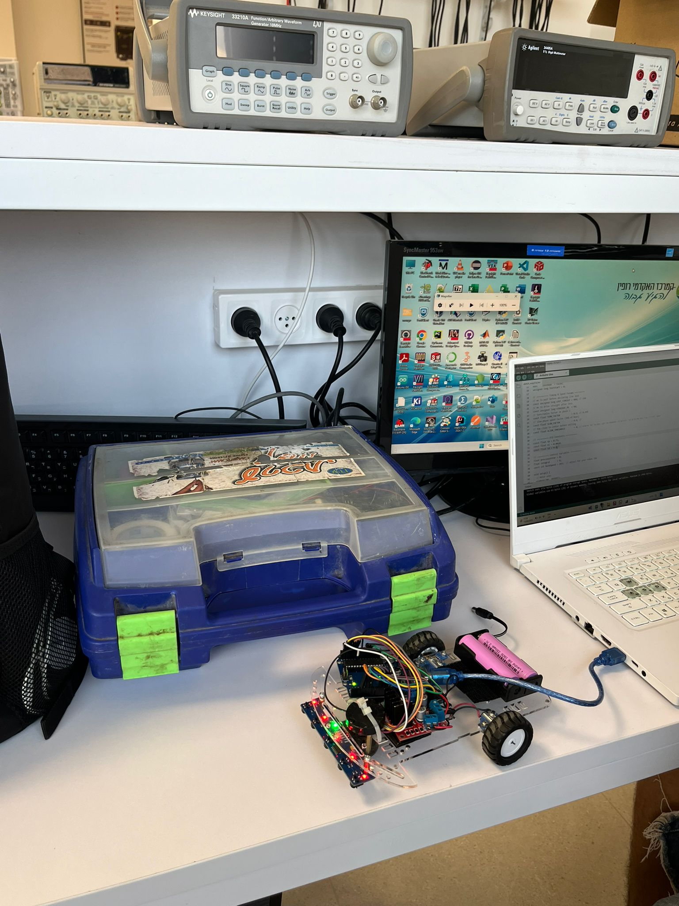
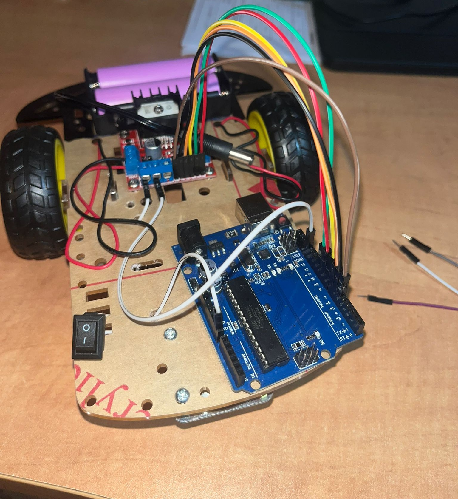
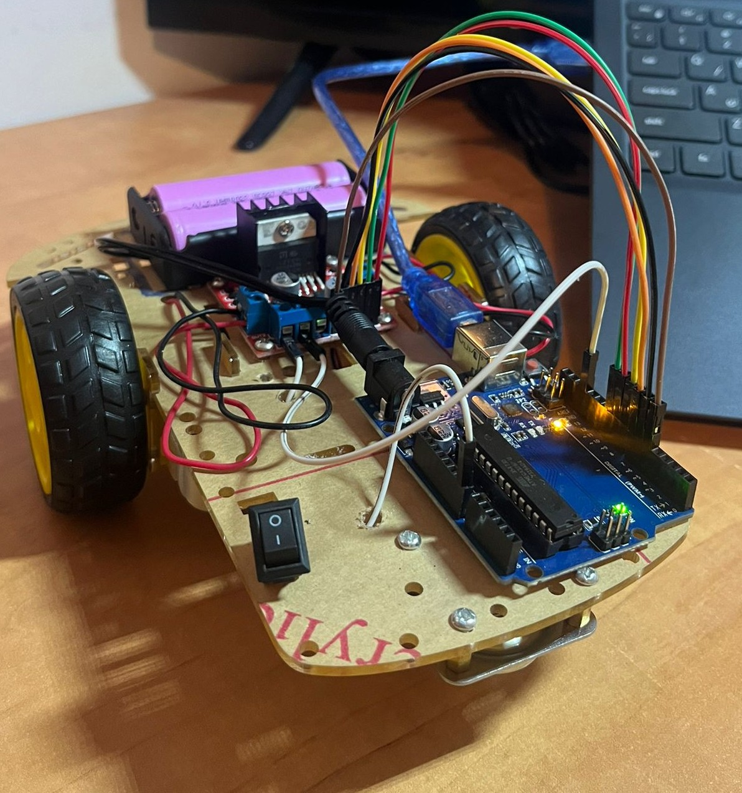

#  Autonomous Line Follower Robot

  <strong>An educational autonomous navigation system using 5-channel IR sensing and differential steering logic.</strong>

---

##  Documentation Hub
Explore the detailed engineering documentation:

|  Architecture & Logic |  Hardware & Specs |
| :--- | :--- |
| ➡️ [**System Architecture Overview**](./docs/SYSTEM_ARCHITECTURE.md) _High-level diagrams, HW/SW breakdown_ | ➡️ [**Hardware Specifications**](./docs/HARDWARE_SPECIFICATIONS.md) _Pinout, components, and wiring_ |
| ➡️ [**Control Logic & Algorithms**](./docs/CONTROL_LOGIC.md) _Decision states, state machine, and flow_ |  [**Source Code**](./src/robot_main_5_sensors.ino) _Main Arduino implementation_ |

---

##  Demo: Robot in Action
Historical demonstration of the original robot; the review firmware has not been physically retested.

### [ Click here to watch the Full Video (High Quality)](./assets/Finale_round.mp4)

---

##  Key Capabilities
* **Precision Sensing:** 5-channel TCRT5000 IR array for granular line position detection.
* **Smart Navigation:** Differential steering logic handling straight paths, curves, and 90° turns.
* **Robust Control:** Prioritized state machine preventing sensor conflict.
* **Power Management:** Split 7.4V distribution for high-current motors and sensitive logic.

---

##  Getting Started
1.  **Prerequisites:** Arduino IDE, Standard USB Cable (Type-B).
2.  **Setup:** Clone this repo and open `src/robot_main_5_sensors.ino`.
3. **Preflight:** Follow [bench validation](docs/BENCH_VALIDATION.md) with motor power disconnected and verify wiring before upload.
4. **Upload and run:** Test with wheels lifted before track trials. Leave experimental PID disabled until calibration.

---

# Repository Structure

---

##  Project Gallery

### 1. Lab Testing Environment
Testing signal integrity using an oscilloscope during development.

### 2. Top View - Wiring & Components
Complete assembly showing cable management and component placement.

### 3. Side View - Power & Chassis
Side profile showing the double-deck chassis and battery placement.

##  PID Control (experimental)

While the current system uses specific logic states, the review firmware includes an experimental **PID Control** mode, pending physical validation (Proportional-Integral-Derivative):

* **Proportional (P):** Steer harder as the error increases.
* **Integral (I):** Correct accumulated errors over time.
* **Derivative (D):** Predict future errors based on rate of change to reduce oscillation.

---
*Designed and implemented by [Idan Vimenetz]*

## Experimental PID and validation
The engineering review adds an optional discrete PID mode, disabled by default. See [bench validation and calibration](docs/BENCH_VALIDATION.md) before enabling it. Host regression and Uno compilation are not physical performance measurements.
